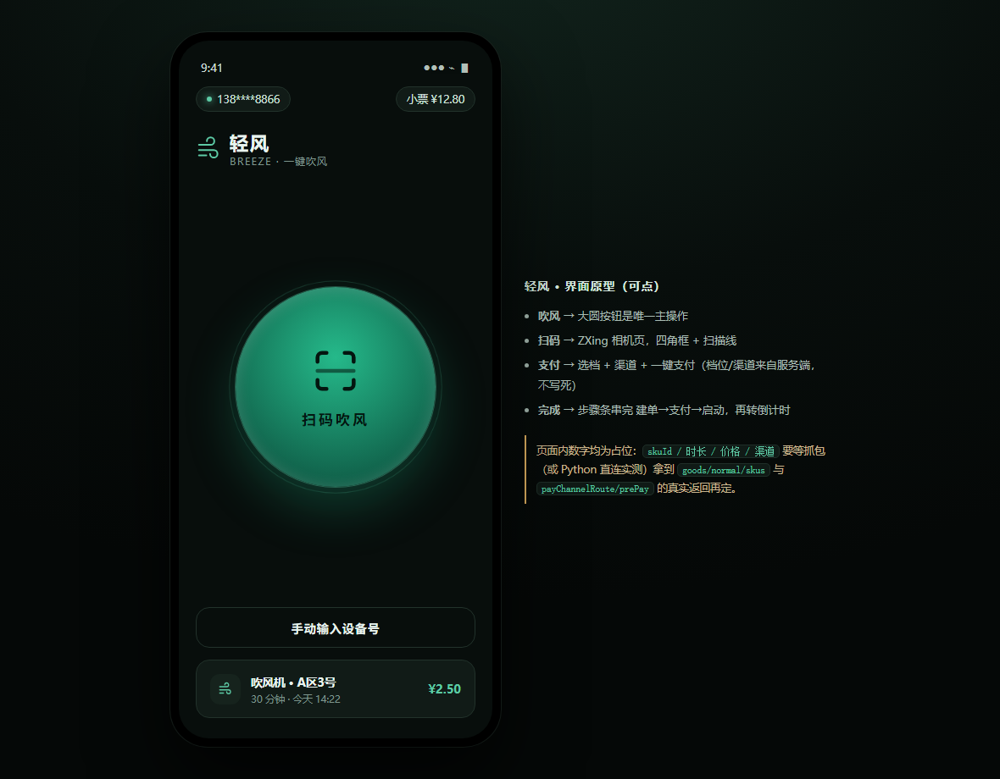
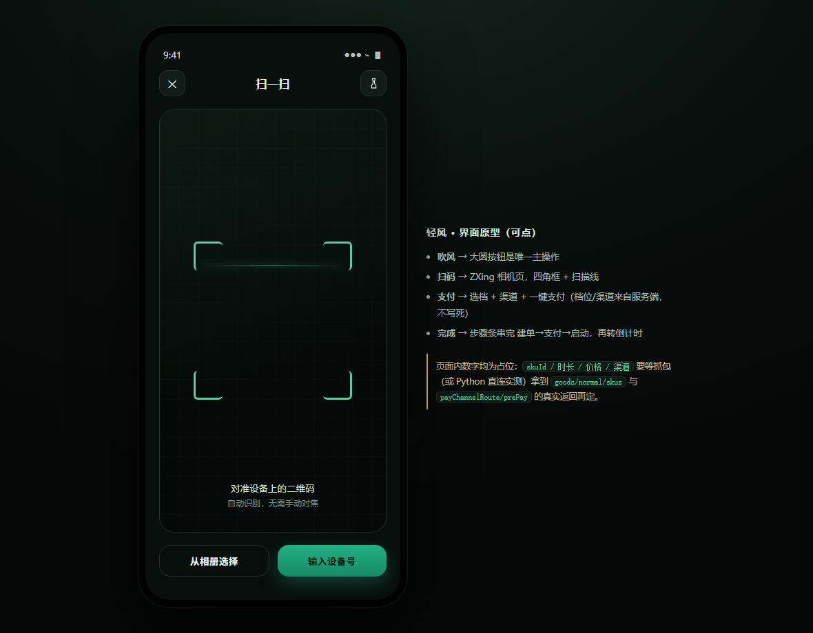
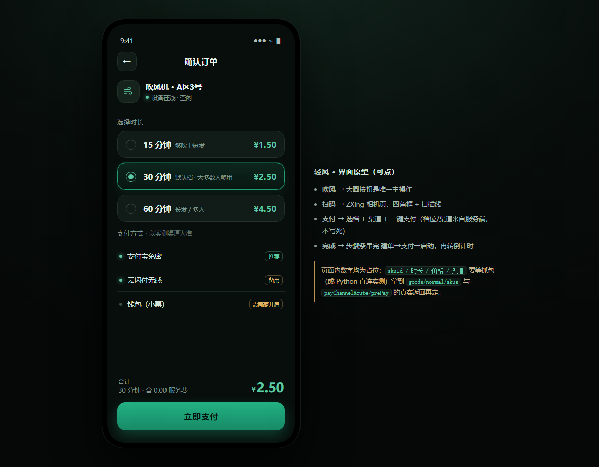
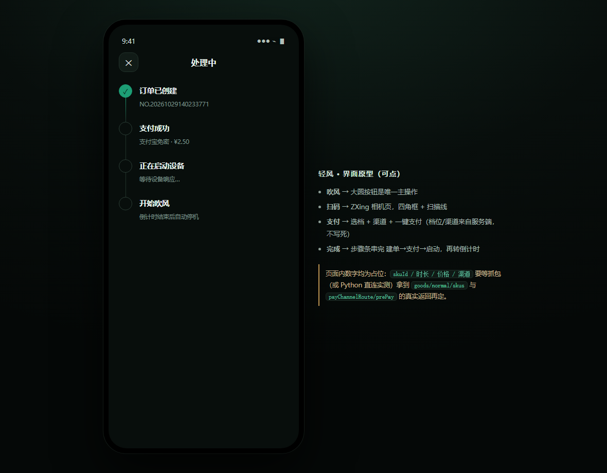
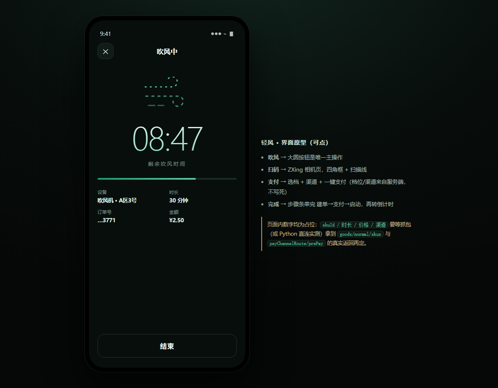

# 轻风 · Breeze

扫码 → 选时长 → 支付 → 吹风。一个只做这件事的 Android 客户端。

官方 App 里塞了开屏广告、扫码闸门广告、收银台广告、红包横幅、看视频任务、商城入口……这个项目把它们全砍掉，
只留下一条四步直线：**点一下扫码，点一下付款，风就来了**。

> 个人自用项目。接口是逆向官方 App 得到的，仅用于学习与自用，请勿商用或大规模分发。

<p align="center">
  
</p>

## 界面

| 首页 | 扫码 | 确认订单 |
|:--:|:--:|:--:|
|  |  |  |

| 处理中 | 吹风中 |
|:--:|:--:|
|  |  |

点开 [docs/prototype.html](docs/prototype.html) 可以在浏览器里点着玩（纯静态，双击即可，无需联网）。

配色只有两个：底色 `#0B0F0E`，薄荷绿 `#3FD69B`。

## 功能

- **短信登录**：手机号 + 验证码，登录态存在 DataStore，杀进程 / 重启手机都不用重登
- **扫码吹风**：CameraX 竖屏取景 + ZXing 解码，扫机器上的二维码直接进订单页；扫不到可以手输设备号
- **档位与渠道**：时长档、价格、支付方式全部来自服务端，代码里没有写死任何数字
- **支付宝 / 微信**：官方 SDK 拉起付款，付完自动确认、自动启动设备
- **吹风计时**：按「结束时刻」算，退出 App、去付款、杀进程回来数字都对得上
- **历史订单**：最近 20 单，状态与官方一致（未支付 / 支付超时 / 已支付 / 已完成 / 退款中 / 已退款）
- **应用内更新**：启动时查一次 `latest.json`，有新版本就下载并调起系统安装器覆盖安装

## 快速开始

需要 JDK 21 + Android SDK（platform 35 / build-tools 35）。没有 wrapper，依赖本地 Gradle 8.9。

```bash
# 命令行
gradle assembleDebug            # 产物 app/build/outputs/apk/debug/app-debug.apk

# 或直接用 Android Studio 打开本目录（Gradle 根工程就是仓库根）
```

推送到 `master` 会触发 GitHub Actions（见 [.github/workflows/build-release.yml](.github/workflows/build-release.yml)）：
自动装 SDK、出 debug 包（Artifacts）、配好签名密钥时再出**正式版 Release**（APK + `latest.json`）。
debug 变体的包名带 `.debug`，可以和正式包同时装在一台手机上。

Windows 本地用我的工具链的话：

```powershell
.\toolchain\build.ps1              # → dist\breeze-debug.apk
.\toolchain\build.ps1 -Release     # → dist\breeze-<version>.apk + dist\latest.json
```

两个本地构建的坑（都已在脚本里绕过）：

1. **工程路径不能有中文** —— AGP 会报 `Your project path contains non-ASCII characters`，用 ASCII 目录联接（junction）绕开
2. **别用 `gradle wrapper`** —— 它会去 HEAD `services.gradle.org` 校验，该域名在某些网络下只回 307，直接失败；用本地 `gradle.bat`

## 发版与自动更新

不走应用商店：APK 自己查 `latest.json` → 下载 → 调起系统安装器覆盖安装。更新源有两种，**推荐 GitHub Releases**。

### 方式一：GitHub Releases（默认，什么都不用托管）

`version.properties` 里默认的 `updateBase` 就是：

```
https://github.com/Anc0nooo/BREEZE/releases/latest/download/
```

推送 `master` 后 CI 会做三件事：出 debug 包（Artifacts）、出**正式签名包**、把
`breeze-<versionName>.apk` 和 `latest.json` 挂到一个**正式版 Release**（tag `v<versionName>`）。
`releases/latest/download/` 这个地址永远指向最新的非预览版 Release，所以 App 里写死它就够了。

配一次 Secrets 就行（Settings → Secrets and variables → Actions）：

| Secret | 内容 |
|---|---|
| `KEYSTORE_BASE64` | 签名文件的 base64（**单行**） |
| `KEYSTORE_PASSWORD` | storePassword |
| `KEY_ALIAS` | keyAlias（本项目是 `breeze`） |
| `KEY_PASSWORD` | keyPassword |

```bash
# 生成第一项（-w0 保证单行，别让 base64 折行）
base64 -w0 toolchain/keystore/breeze-release.jks
# Windows PowerShell:
[Convert]::ToBase64String([IO.File]::ReadAllBytes("toolchain\keystore\breeze-release.jks"))
```

没配这四项也能跑，只是只会出 debug 包（工作流会打一条 warning）——因为**签名必须是同一把**，
用 debug key 签出来的包装不到正式版上面。

发一版就是：

```bash
# 1. 改版本号（versionCode 必须递增，否则手机不会认为有新版本）
#    versionCode=5  versionName=1.2.1
# 2. push
git push
# 3. 等 Actions 绿了，手机下次启动自动弹更新
```

### 方式二：自己的服务器

```powershell
# 打包时不写 GitHub 地址，改成自己的 https 目录
.\toolchain\build.ps1 -Release -UpdateBase https://your.domain/breeze/
# → dist\breeze-1.2.0.apk + dist\latest.json

.\toolchain\deploy.ps1 -Ssh root@你的服务器 -RemoteDir /var/www/breeze
```

服务器上只需要两个文件，和 Release 里那两个 asset 是同一份东西：

```
https://your.domain/breeze/latest.json
https://your.domain/breeze/breeze-1.2.0.apk
```

`latest.json` 长这样（`url` 写相对路径即可，相对 `updateBase`）：

```json
{
  "versionCode": 4,
  "versionName": "1.2.0",
  "url": "breeze-1.2.0.apk",
  "notes": "修了什么什么",
  "size": 13194763,
  "force": false
}
```

### 四条必须记住的

1. **签名是命门。** `toolchain/keystore/breeze-release.jks` 丢了，线上所有人就再也收不到覆盖升级，只能卸载重装。请单独备份（口令在本地 `keystore.properties`，**不入库**）。
2. **`updateBase` 必须 https、以 `/` 结尾**，改完要重新打包（这个值编译进了 `BuildConfig.UPDATE_BASE`）。App 里 `usesCleartextTraffic=false`，http 地址拿不到更新。优先级：`-PupdateBase=` > 环境变量 `BREEZE_UPDATE_BASE` > `version.properties`。
3. **`versionCode` 只增不减**，App 只比较它。
4. **静态站如果开了 SPA 回退**（`try_files $uri $uri/ /index.html`），`/breeze/latest.json` 不存在时会回 200 + 一段 HTML，App 会明确报「更新地址返回的是网页而不是 JSON」——给这个目录单独加一条 `location /breeze/ { root …; try_files $uri =404; }` 就好。

安装动作走 `PackageInstaller` 会话（`MODE_FULL_INSTALL`）：不需要存储权限、不用 FileProvider，第一次会让你允许「安装未知应用」。

> 换过签名或换过 `updateBase` 的那一版，老用户要先**手动装一次**；从下一个版本起才会自动更新。
> （1.1.x 发布时 `updateBase` 指向自建站，1.2.0 改成 GitHub，所以 1.1.x 用户手动装一次 1.2.0 之后就自动跟 GitHub 走了。）

## 技术要点

都是实测出来的，详细推导见 [docs/design.md](docs/design.md)。

**登录**

| 步骤 | 接口 | 参数 |
|---|---|---|
| 发短信 | `common/sms/sendCode` | `{phone, template:"reg"}` |
| 登录 | `user/reg` | `{channel:"android_app", phone, verify:"<短信码>"}` → `data.token` |

`user/smsCode` 是「已登录后换手机号」用的，未登录调用一律回「未登录」；短信码字段名是 `verify`
（R8 把常量 `AdFlowReporter.TRAFFIC_VERIFY` 改名成了这个），传 `authCode`/`code` 只会得到「参数不正确」。

**签名**（`data/Sign.kt`）

```
SHA-256("appSecret=…&channel=android_app&timestamp=<ms>&token=<token>&version=<ver>&/<path>")
→ header Timestamp: <ms> / Sign: <hex>
```

两个 header 名必须首字母大写 —— 小写会命中服务端把「没签名」误报成 **`版本过低，请升级APP`** 的兜底分支，
这个坑花了大半天。body 侧那套 `_sign`/`_appid` 看起来是双签名，其实 `NetworkApi` 从没注册过
`SignInterceptor`，是死代码。

**扫码**：`QrScanner.kt` 用 CameraX `Preview` + `ImageAnalysis`，解码在单线程 executor 里做，
只取 YUV 的 Y 平面喂 `PlanarYUVLuminanceSource`。**没有用** `zxing-android-embedded` 的 `CaptureActivity`——
它是独立 Activity、自带横屏取景界面，和竖屏深色界面对不上。

**支付**（`BreezeViewModel.pay()`，顺序是死的）

```
trade/create            → 建单，拿 tradeNo（额外 header：imei/categoryCode/lat/lng + orderRiskSign/orderRiskTimestamp）
pay/unify/prePay        → {orderNo, payType:<渠道 method>, againFlag:"1"} → data.prepayParam
支付宝 PayTask.payV2     → prepayParam 就是 orderInfo，resultStatus=9000 即成功
微信   WXAPIFactory      → prepayParam 是 JSON，组装 PayReq；结果由 WXEntryActivity 回传 errCode
order/pay_status        → 轮询确认（6 × 1.2s）
trade/order/start       → 启动设备
machine/device_is_start → 轮询启动状态（10 × 1s）
```

几个只有踩过才知道的细节：

- `trade/preview/v4` 的 `items` 必须带 `soldType:"1"`，**不能带 `price`**；吹风机的 `amount`/`num` 都填分钟数，价格由服务端按 `extAttr.perPrice` 算
- `promotions` 千万别把 preview 返回的那个空壳数组原样回传，传 `"[]"`
- `hitAd`/`useTicket` 是 Integer（传 `"0"`），`combineOrderStatus` 是 Boolean，`shopId` 是 Long 且必须用 `orgId`
- 服务端不少字段是 JSON `null`，`optString` 会给出字面量 `"null"`，统一走 `BreezeRepo.clean()` 洗掉
- 任何一步失败都停在「完成」页对应步骤并把 `code` 写进副标题，**不假装成功**

**计时**：不存剩余秒数，只存 `endAt`（epoch ms），剩余时间每次现算，并落盘到 DataStore。
所以退出 App、切后台、进程被杀都不影响；冷启动读回 `endAt` 还没到点就直接回到倒计时页。

**历史订单**：`order/list`，body `{page, pageSize}`，列表键是 `data.items`。

## 项目结构

```
.
├── app/                          Android 模块
│   ├── build.gradle.kts          compileSdk 35 / minSdk 24 / targetSdk 34
│   └── src/main/java/com/pangguai/breeze/
│       ├── MainActivity.kt       唯一 Activity：Compose 宿主 + 返回键 + 更新弹窗
│       ├── BreezeViewModel.kt    单屏状态机（SPLASH/LOGIN/HOME/SCAN/PAY/DONE/HISTORY）
│       ├── data/
│       │   ├── Sign.kt           header 签名
│       │   ├── Api.kt            OkHttp 表单 POST，自动带签名与 token
│       │   ├── BreezeRepo.kt     所有接口调用的唯一出口
│       │   ├── Session.kt        DataStore：token / 手机号 / 进行中的吹风
│       │   ├── Alipay.kt         支付宝 SDK 封装
│       │   ├── Wechat.kt         微信 SDK 封装
│       │   └── Update.kt         latest.json → 下载 → PackageInstaller
│       └── ui/                   Compose 界面：Home / Scan / Pay / Done / History / Login
├── docs/
│   ├── design.md                 设计稿与接口推导（含被推翻的旧结论，保留对照）
│   ├── prototype.html            可点的界面原型
│   └── screens/                  截图
├── toolchain/                    本机构建/部署脚本（build.ps1、deploy.ps1、keystore）
├── version.properties            版本号 + 更新源地址
└── .github/workflows/            CI：推 master 自动出 debug APK
```

## 已知限制

| 项 | 说明 |
|---|---|
| 微信支付 | SDK 与回调都接好了，但商户 appid 绑定的是官方 App 的包名+签名，自建包大概率被微信拒（界面会显示 `errCode`）。**实测只有支付宝这条路能跑通。** |
| 银联 / 农行 | 服务端会返回这两档，需要各自的 SDK，目前标「暂未接入」 |
| 设备类型 | 只做吹风机（`categoryCode=03`），其它设备提示暂不支持 |
| 登录态 | 服务端 token 约 1 小时过期，没有 refresh 接口，过期只能重新收验证码；部分号码会返回 `forcedBind`（要求先在官方 App 绑定微信/支付宝），这类号用不了 |
| 多用户 | 按单人自用设计，没有账号体系与配置同步 |

## 文档

- [docs/design.md](docs/design.md) —— 最初的设计稿：产品定义、界面规格、屏 × 接口映射、写链路推导
- [docs/prototype.html](docs/prototype.html) —— 五屏可点原型（就是 UI 落地的依据）

## 免责

接口、签名算法与字段含义均来自对公开下载的官方 APK 的静态分析，仓库里不含任何官方二进制文件。
本项目仅用于个人学习与自用，不提供任何担保；因使用产生的费用、账号或设备问题由使用者自行承担。
